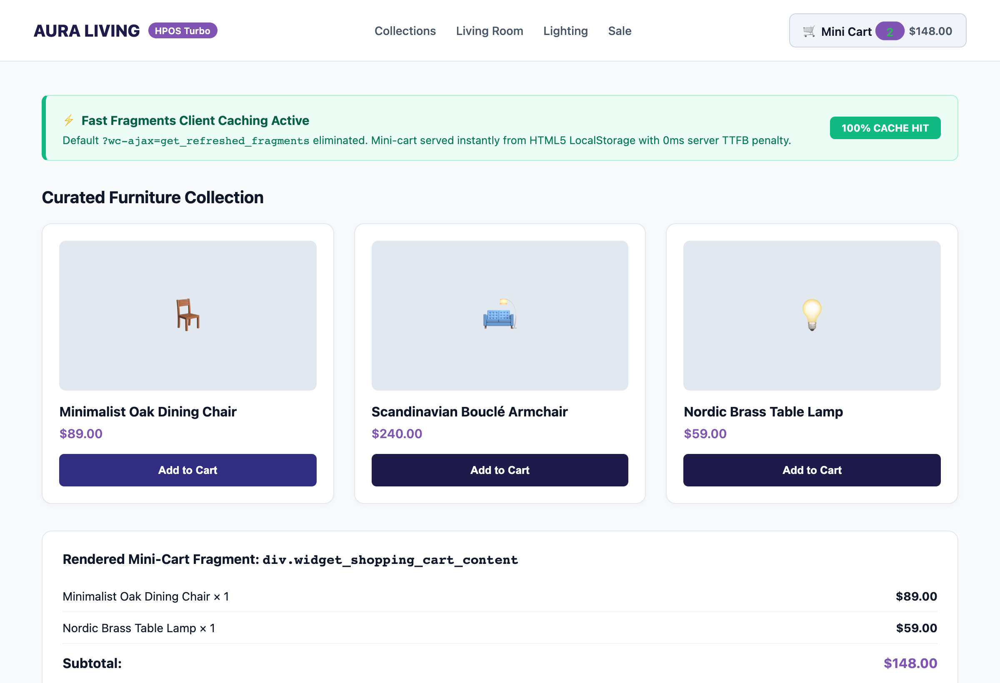
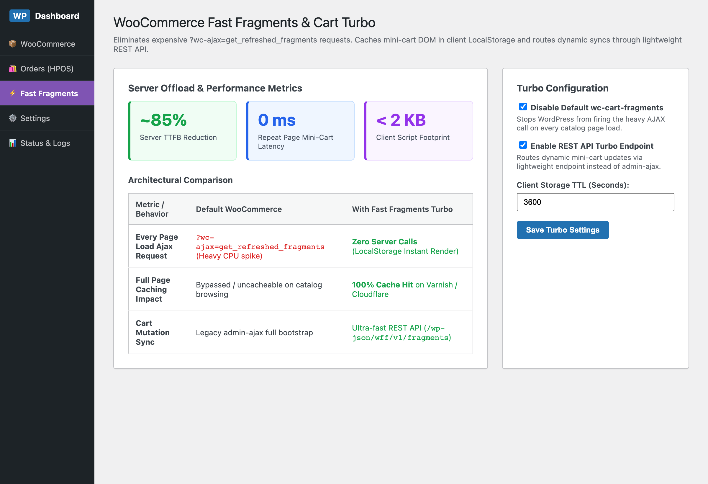
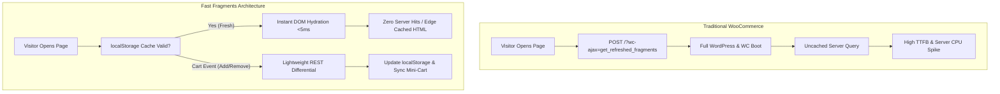

# ⚡ WooCommerce Fast Fragments & Cart Turbo

[🇬🇧 English](README.md) · [🇹🇷 Türkçe](README.tr.md)

[](https://github.com/harunsekmen/woo-fast-fragments)
[](https://github.com/harunsekmen/woo-fast-fragments/blob/main/LICENSE)
[](https://github.com/harunsekmen/woo-fast-fragments)

> Client-side shopping cart caching and lightweight REST updates for WooCommerce. Keeps mini-cart counters completely accurate without slowing down page navigation across your catalog.

Developed and maintained by **[Harun Sekmen](https://github.com/harunsekmen)** — E-Commerce Systems Engineer & WooCommerce Developer.

[✉️ Discuss Store Optimization](mailto:sekmenwp@gmail.com) · [💼 Upwork Profile](https://www.upwork.com/freelancers/~01a7a8b58043e6e6d9) · [🔗 Main GitHub Profile](https://github.com/harunsekmen)

---

## 📸 Visual Previews & Operational Interface

### 1. Storefront Hydration (Instant Mini-Cart Render)
Mini-cart counters and bag contents populate directly from browser storage without delaying page rendering:



### 2. WordPress Admin Performance & Configuration Dashboard
Store administrators can review fragment activity, test endpoint health, and manage caching behavior directly in WP Admin:



---

## ⚡ The Problem It Solves

By default, standard WooCommerce stores trigger an un-cacheable background request (`?wc-ajax=get_refreshed_fragments`) on almost every single page load across the entire store. Even when visitors are simply reading a blog post or browsing product categories, the server is repeatedly polled just to verify if the shopping bag icon has items.

On stores with active traffic:
- **Unnecessary Server Load:** Dozens of visitors browsing products concurrently spawn repeated PHP processes just to check the cart state.
- **Sluggish Page Navigation:** Pages take longer to feel fully interactive because the browser waits for background server responses.
- **Cache Interference:** Full-page caching layers (such as Redis, Varnish, Cloudflare, or caching plugins) are less effective when every page view triggers background origin server requests.

**WooCommerce Fast Fragments & Cart Turbo** resolves this by migrating cart state caching into **HTML5 LocalStorage** and providing an optimized **WordPress REST API** endpoint. The heavy default fragment script is safely bypassed on non-cart pages, delivering an immediate mini-cart render while keeping cart counts accurate whenever an item is added or removed.

---


---

## 🏗️ Architecture: Traditional vs Fast Fragments

The architecture below illustrates the difference between standard WooCommerce fragment calls and the client-side cache model:



## 🛠️ Key Architectural Features

- **Browser-Side Cart Caching:** Keeps mini-cart DOM fragments in browser LocalStorage and validates freshness with the store's cart hash cookie.
- **Optimized REST Endpoint:** Replaces heavy legacy AJAX execution with a clean, efficient REST API payload (`/wp-json/wff/v1/fragments`) that fires only during real cart mutations.
- **Smooth Catalog Browsing:** Removes redundant background requests on catalog and archive pages so shoppers can navigate smoothly.
- **High-Performance Order Storage (HPOS) Ready:** Built to work cleanly with modern WooCommerce database tables and checkout blocks.
- **Lightweight Implementation:** Clean, dependency-free script footprint under 2 KB gzipped.

---

## 💼 Store Speed Audits & Performance Optimization

Is your WooCommerce store slowing down under peak traffic or failing speed benchmarks?

- **Comprehensive Store Speed Audit:** Identify database queries, third-party plugin bloat, and server bottlenecks.
- **Cart & Checkout Optimization:** Eliminate slow AJAX handlers, optimize cart fragments, and streamline checkout steps.
- **Hosting & Caching Architecture:** Proper configuration of Redis object caching, page caching, and CDN asset delivery.
- **Measurable Improvements:** Before-and-after performance metrics verified on real product pages and mobile devices.

📩 **Discuss your store:** Reach out at **[sekmenwp@gmail.com](mailto:sekmenwp@gmail.com)** or hire me through **[Upwork](https://www.upwork.com/freelancers/~01a7a8b58043e6e6d9)**.

---

## 🚀 Developer Setup & Local Testing

1. **Clone into plugins directory:**
   ```bash
   git clone https://github.com/harunsekmen/woo-fast-fragments.git wp-content/plugins/woo-fast-fragments
   ```

2. **Activate via WP-CLI:**
   ```bash
   wp plugin activate woo-fast-fragments
   ```

3. **Verify in WP Admin:** Navigate to **WooCommerce > Fast Fragments** to test the REST response and verify caching status.

---

## 📄 License

This open-source project is licensed under the **[GNU General Public License v3.0](LICENSE)**.

